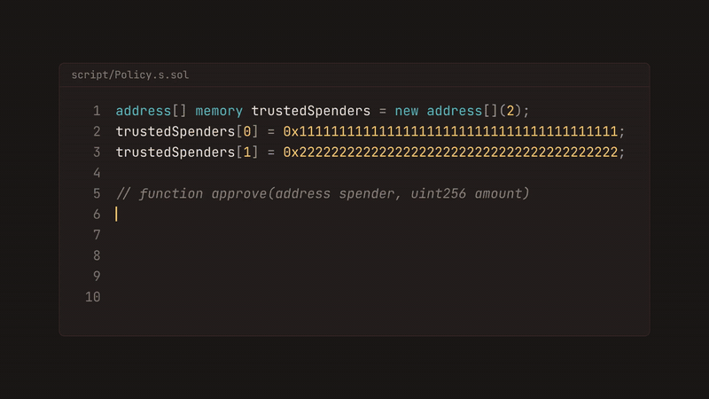

<picture>
  <source media="(prefers-color-scheme: dark)" srcset="packages/docs/public/logo-vertical-dark.svg" />
  
</picture>

<strong>Calldata Policy Engine</strong>

Constraints on ABI-encoded calldata, built and enforced with a Solidity library or a TypeScript SDK.

[Documentation](https://callcium.dev/docs)

 

<a href="https://callcium.dev">
<picture>
  <source media="(prefers-reduced-motion: reduce)" srcset=".github/readme/hero-still.png" />
  
</picture>
</a>

## Overview

**Problem.** ABI-encoded calldata is opaque at the contract boundary. Checks on it are written by hand in each contract, and offchain code has no shared format to evaluate the same rules.

**Solution.** Callcium encodes constraints on ABI-encoded data into one binary policy. The Solidity library enforces it onchain, the TypeScript SDK enforces it offchain, and both reach the same verdict. A contract stores its policy as data, so its rules change without redeploying the contract.

## Repository

| Path | Contents |
|------|----------|
| [`packages/contracts`](./packages/contracts) | Solidity library |
| [`packages/sdk`](./packages/sdk) | TypeScript SDK |
| [`packages/docs`](./packages/docs) | Documentation site, [callcium.dev](https://callcium.dev) |
| [`spec`](./spec) | Binary format specifications, Lean model, conformance vectors |

[Security policy](SECURITY.md)&ensp;&middot;&ensp;[Contributing](CONTRIBUTING.md)&ensp;&middot;&ensp;[MIT license](LICENSE)
